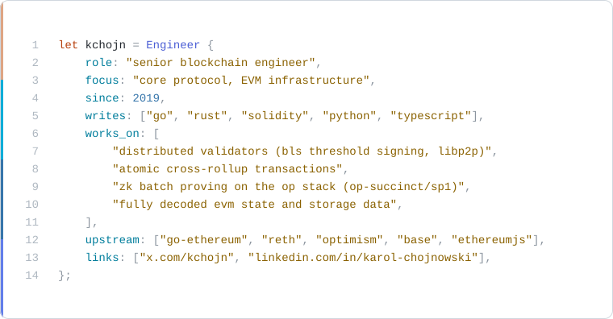

<picture>
  <source media="(prefers-color-scheme: dark)" srcset="assets/profile-dark.svg">
  
</picture>

  <a href="https://x.com/kchojn">x</a> . <a href="https://www.linkedin.com/in/karol-chojnowski">linkedin</a>

